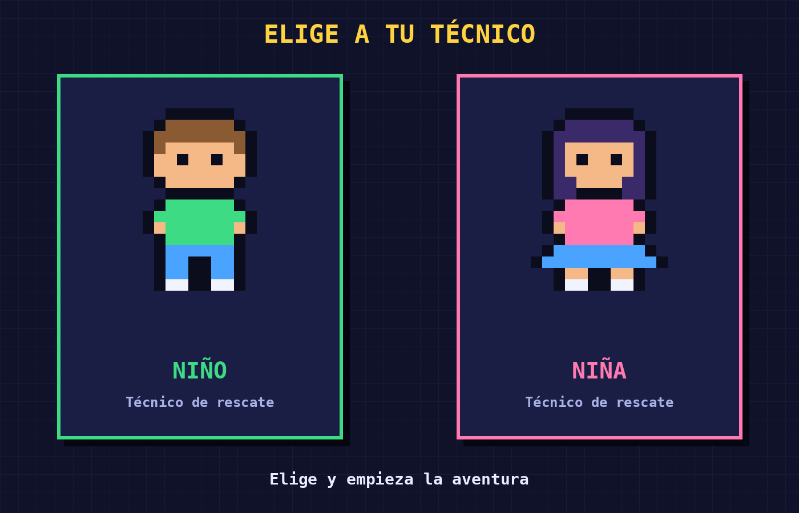

# Linux Rescue: el juego de reparar computadores con comandos

Prototipo del proyecto de **Sistemas Operativos** (Grupo 6).

**Integrantes:** 
1. Paula Román
2. Hayder Carreño
3. David Bonilla.

## 1. Levantamiento de información

**Necesidad:** Los estudiantes de Sistemas Operativos necesitan una forma segura, práctica y motivadora de aprender los comandos básicos de Linux.

### Problemática
| Problema | Consecuencia |
|---|---|
| La terminal parece intimidante y aburrida | Los estudiantes evitan practicarla |
| Miedo a dañar un sistema real | No se anima a probar comandos |
| Se enseña mucha teoría y poca práctica | Se memorizan comandos sin entenderlos |
| Poca retroalimentación inmediata | No se sabe por qué un comando falló |
| Pocas herramientas atractivas | Baja motivación |

### Público objetivo
Estudiantes principiantes de Sistemas Operativos e Ingeniería.

### Solución propuesta
Un videojuego web que convierte el aprendizaje de Linux en una aventura con retos, puntos y retroalimentación.

## 2. Descripción del proyecto

**Linux Rescue** es un videojuego web 2D en estilo pixel art. El jugador elige un técnico (niño o niña) que recorre un pasillo lleno de computadores dañados. En cada uno aparece una falla y debe repararla con comandos de Linux en una terminal simulada.



### Objetivo general
Desarrollar un videojuego web que enseñe a resolver problemas básicos de un computador usando comandos de Linux.

### Objetivos específicos
- Diseñar niveles con fallas comunes del sistema.
- Implementar un validador que revise los comandos del jugador.
- Dar retroalimentación y comandos alternativos en cada intento.
- Guardar el progreso y el puntaje del jugador.

### Dificultad progresiva
| Ciclo | Niveles | Modo | Monitor |
|---|---|---|---|
| 🥉 Bronce | 1 y 2 + jefe | Guiado (arrastrar bloques) | Monitor viejito |
| 🥈 Plata | 3 y 4 + jefe | Experto (escribir) | Monitor moderno |
| 🥇 Oro | 5 y 6 + jefe | Experto sin pistas fáciles | PC gamer |

---

## 3. Funcionalidades

### Flujo de una partida
1. Pantalla de inicio: elegir personaje y nombre.
2. El técnico camina por el pasillo hasta un computador dañado.
3. El monitor muestra la falla (ej. "disco al 100%").
4. El jugador la repara en la terminal.
5. El juego valida el comando y da retroalimentación.
6. Al arreglar todos los computadores, enfrenta al jefe final.

### Mecánicas
- ❤️ **Vidas:** 3 por nivel.
- 💡 **Pistas:** hasta 2 por nivel (restan puntos).
- ⭐ **Puntaje:** premia rapidez y pocos errores.
- 🏅 **Medallas:** una por ciclo completado.
- 📖 **Glosario:** guarda los comandos aprendidos.
- 🔁 **Alternativas:** sugiere otras formas de resolver el problema.
- 👾 **Jefe final:** examen con varias fallas seguidas.

### Comandos del juego
| Comando | Qué enseña |
|---|---|
| `ls`, `cd`, `pwd` | Navegar por carpetas |
| `df -h`, `du` | Revisar el espacio en disco |
| `rm` | Borrar archivos |
| `ps`, `kill` | Ver y detener procesos |
| `cat`, `mkdir` | Leer archivos y crear carpetas |

## 4. Estructura del prototipo

### Front end
```
Prototipo_Sistemas-Operativos_G6/
├── index.html
├── css/        (estilos y animaciones)
├── js/         (lógica, validador de comandos, niveles)
├── img/        (sprites pixel art)
├── db/         (script SQL y datos de niveles)
└── README.md
```

### Commits
Usamos mensajes cortos con prefijo:
- `feat:` nueva función. `fix:` corrección. `docs:` documentación. `style:` diseño.
- Ejemplo: `feat: validador de comandos del nivel 1`.
- Cada integrante trabaja en su rama y se une a `main` por *pull request*.

### Base de datos
Modelo relacional (SQLite):

| Tabla | Campos principales |
|---|---|
| **usuario** | id (PK), nombre, personaje |
| **nivel** | id (PK), ciclo, numero, problema, es_jefe |
| **comando** | id (PK), nombre, descripcion |
| **solucion** | id (PK), nivel_id (FK), comando_id (FK), es_alternativa |
| **progreso** | id (PK), usuario_id (FK), nivel_id (FK), puntaje, intentos, completado |

**Relaciones:** un usuario tiene muchos progresos; un nivel tiene muchas soluciones; un comando puede servir en muchas soluciones.

## 5. Tecnologías
- **HTML:** interfaz del juego.
- **CSS:** diseño pixel art y animaciones.
- **JavaScript:** lógica del juego.
- **SQLite:** base de datos del prototipo.
- **Git y GitHub:** control de versiones.
- **Visual Studio Code:** editor.
